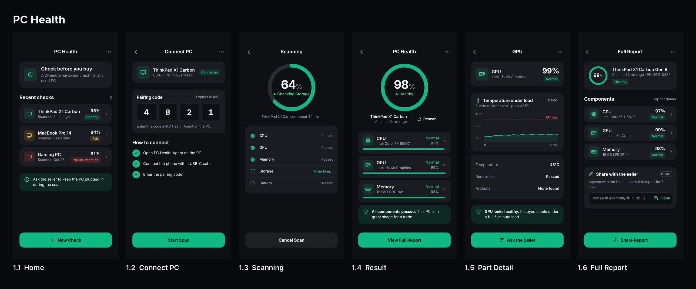
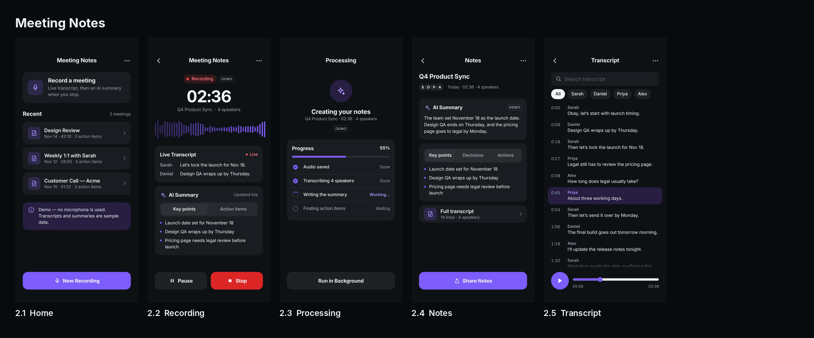
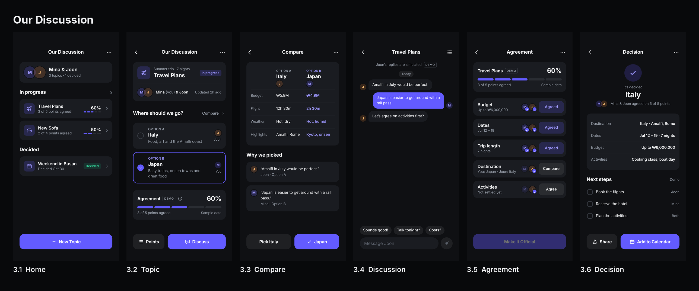
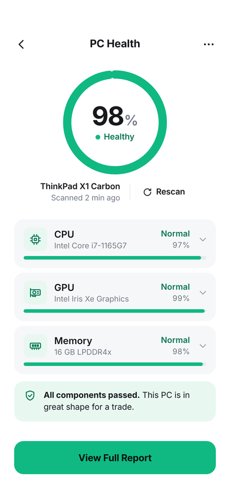
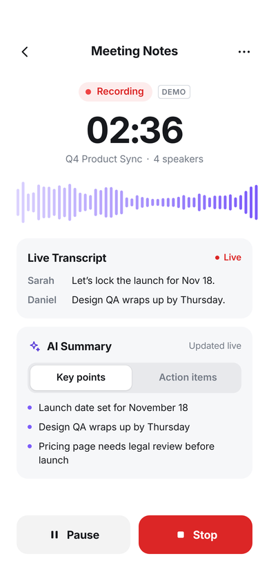
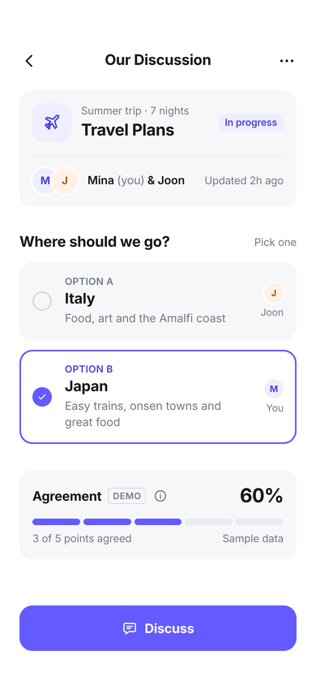
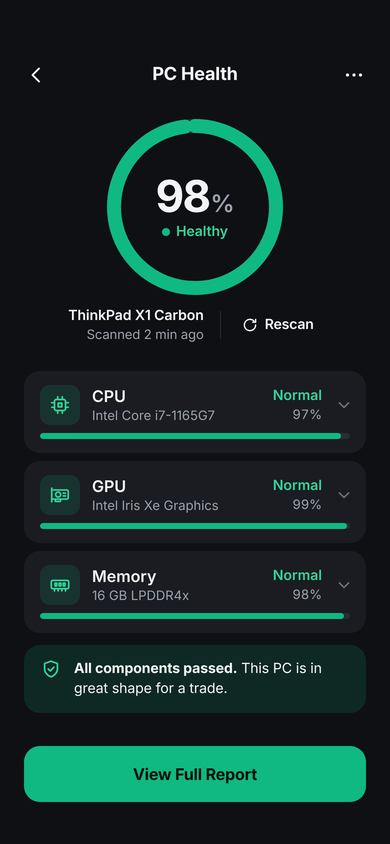
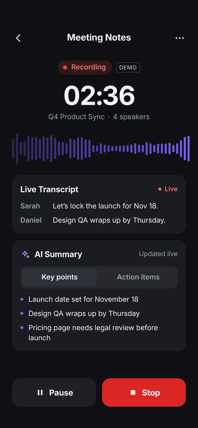
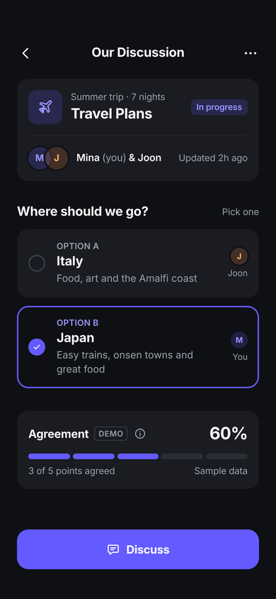
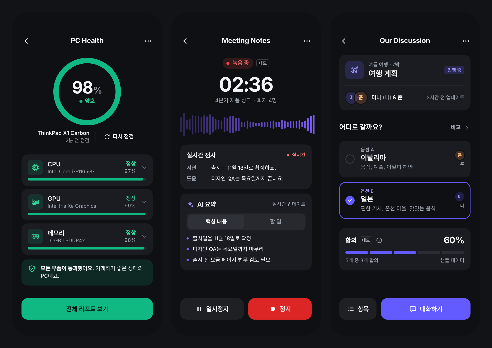

# Mobile UI Kit

순수 HTML · CSS · JavaScript로 만든 모바일 앱 UI 키트입니다. 라이트·다크 테마를 모두 지원하고, 외부 프레임워크나 빌드 도구 없이 쓸 수 있습니다. 들어 있는 것은 다음과 같습니다.
- 디자인 시스템
- 완성된 앱 3개(PC Health · Meeting Notes · Our Discussion)
- 새 앱 생성기
- IDE 에이전트용 규칙과 프롬프트
- 사진 합성 도구

## 시나리오 프로토타입 (PoC)

세 앱 모두 대표 화면 앞뒤로 이어지는 주요 화면을 갖춘, 실제로 눌러 볼 수 있는 프로토타입입니다. 핵심 기능만 동작합니다.

| 시나리오 | 화면 흐름 (★ 대표 화면) |
|---|---|
| PC Health (6) | Home → Connect PC → Scanning → ★Result → Part Detail · Full Report |
| Meeting Notes (5) | Home → ★Recording → Processing → Notes → Transcript |
| Our Discussion (6) | Home → ★Topic → Compare · Discussion · Agreement → Decision |





- **보기:** `flows.html`에서 모든 화면을 시나리오 순서대로 봅니다.
- **눌러 보기:** `index.html`에서 ▶ Play를 누릅니다.
- **폰에서 열기:** `python3 -m http.server 8080 --bind 0.0.0.0`을 실행한 뒤 폰에서 `http://<PC IP>:8080/pc-health-home.html`을 엽니다.
- **자동 점검:** `node scripts/walkthrough.mjs`
- **시나리오 스토리**(페르소나, 상황과 문제, 사용자 여정, 성공 기준, 시연 대본)는 `docs/scenario-stories.md`에 있습니다. 발표·기획 공유용입니다.
- 흐름표와 핵심 기능 목록은 `apps/scenarios.md`에 있습니다. 화면을 더 만들 때는 `prompts/06-scenario-screens.md`를 씁니다.

## IDE에서 앱 이어서 만들기 (빠른 시작)

1. 이 폴더를 IDE(Claude Code, Cursor, Codex, Copilot 등)로 엽니다. 규칙 파일이 자동으로 적용됩니다.
   - `CLAUDE.md`: Claude Code
   - `AGENTS.md`: Codex 등
   - `.cursor/rules/mobile-ui-kit.mdc`: Cursor
   - `.github/copilot-instructions.md`: Copilot
2. `apps/backlog.md`에 만들 앱의 **이름과 목적**을 적습니다. 04–27번이 빈칸으로 준비되어 있습니다.
3. 에이전트에게 이렇게 시킵니다.
   > `prompts/00-project-brief.md`를 읽고, `prompts/02-batch-from-backlog.md`대로 진행해줘.
4. 3개가 끝날 때마다 `index.html`에서 결과를 확인하고, 고칠 점은 `prompts/03-review.md`로 지시합니다.

앱 하나만 직접 만들려면 다음처럼 합니다.
```bash
node scripts/new-app.mjs habit-tracker "Habit Tracker" "#F97316" "Daily habits and streaks"
# → habit-tracker.html, styles/apps/habit-tracker.css, scripts/apps/habit-tracker.js 생성 + apps/registry.js 등록
#   액센트에 맞는 글자색·약한 배경·버튼 글자색을 라이트·다크 대비(4.5:1 이상)로 계산해 줍니다.
```
프롬프트 설명은 `prompts/README.md`, 사진 합성은 `tools/composite/README.md`를 보세요.

| | PC Health | Meeting Notes | Our Discussion |
|---|---|---|---|
| Light |  |  |  |
| Dark |  |  |  |

## 바로 실행

```bash
# 방법 1 — 아무 정적 서버
python3 -m http.server 8080        # → http://localhost:8080

# 방법 2 — npm
npm start                          # npx serve, → http://localhost:8080
```

`index.html`을 더블클릭해 `file://`로 열어도 동작합니다. 다만 데모 데이터 저장(localStorage)은 브라우저에 따라 서버로 열어야 유지됩니다.

## 폴더 구조

```
mobile-ui-kit/
├─ index.html              미리보기: 시나리오별 화면 목록(▶ Play), 테마, 상태바, UI-only, 캡처 가이드, 390×844 검사
├─ flows.html              모든 화면을 시나리오 흐름 순서로 나열한 보드
├─ <app>-<screen>.html     시나리오 상세 화면 14개 (예: pc-health-scan.html)
├─ pc-health.html          01 PC Health      (액센트 #10B981)
├─ meeting-notes.html      02 Meeting Notes  (액센트 #7C5CFA, 녹음 #EF4444)
├─ our-discussion.html     03 Our Discussion (액센트 #635BFF)
├─ <id>.html               새 앱 (scripts/new-app.mjs가 생성)
├─ apps/
│  ├─ registry.js          앱 목록 — 미리보기·캡처·검사가 읽음
│  ├─ backlog.md           만들 앱 목록과 진행 상태 (04–27 빈칸)
│  └─ scenarios.md         시나리오별 화면 흐름표
├─ styles/
│  ├─ tokens.css           디자인 토큰 — 색(라이트·다크), 타입, 간격, 반경, 크기   ← 재사용
│  ├─ components.css       공통 컴포넌트 — 화면 셸, 아이콘, 버튼, 카드, 시트…    ← 재사용
│  ├─ screens.css          기존 앱 3개 전용 스타일 (ph- / mn- / od-)
│  ├─ flows.css            시나리오 상세 화면 공용 (fl-*)
│  ├─ preview.css          index.html · flows.html 전용
│  └─ apps/<id>.css        새 앱: 액센트(라이트·다크) + 전용 스타일
├─ scripts/
│  ├─ app.js               셸: 테마, 시트, 토스트, 스크롤 포그, 검사, 미리보기, 기존 3개 로직  ← 재사용
│  ├─ apps/<id>.js         새 앱 로직 (AUKit.defineScreen)
│  ├─ flows/<app>.js       시나리오 상세 화면 로직
│  ├─ new-app.mjs          새 앱 생성기
│  ├─ new-screen.mjs       기존 앱에 상세 화면 추가
│  ├─ walkthrough.mjs      시나리오 자동 클릭 점검 (Playwright)
│  └─ capture.mjs          Playwright PNG 캡처
├─ templates/starter.html  최소 화면 예시
├─ prompts/                IDE 에이전트용 프롬프트 (브리프, 새 앱, 일괄, 검수, 캡처, 합성, 시나리오 화면, PoC)
├─ tools/composite/        캡처 PNG → 폰 사진 합성 (Python)
├─ CLAUDE.md · AGENTS.md · .cursor/rules/ · .github/copilot-instructions.md   IDE 규칙 (같은 내용)
├─ docs/                   시나리오 스토리(scenario-stories.md), README 미리보기 이미지
└─ package.json
```

## 테마

| 방법 | 동작 |
|---|---|
| 아무것도 안 함 | OS 설정을 따름 (`prefers-color-scheme`) |
| `<html data-au-theme="dark">` / `"light"` | 강제 지정 |
| URL `?theme=dark` · `light` · `system` | 그 페이지에서만 강제 |
| `AUKit.theme.set('dark')` | 강제 + 저장(localStorage `au-theme`), 다음 방문에도 유지 |
| 미리보기의 Theme 버튼 · `T` 키 · 단독 페이지 하단 Theme 버튼 | 위와 같음 |

```js
AUKit.theme.get();        // 'system' | 'light' | 'dark'
AUKit.theme.resolved();   // 실제 적용 중인 'light' | 'dark'
AUKit.theme.set('dark');
AUKit.theme.cycle();      // system → light → dark
document.addEventListener('au:theme', (e) => console.log(e.detail)); // { theme, resolved }
```

모든 색은 `tokens.css`의 역할 토큰(`--au-bg-layer`, `--au-fg-neutral`, `--au-accent` …)에서만 오기 때문에, 컴포넌트를 고치지 않아도 테마가 바뀝니다. 각 HTML의 `<head>`에 있는 짧은 인라인 스크립트가 첫 렌더링 전에 테마를 정해서, 페이지를 열 때 화면이 깜빡이지 않습니다.

## 언어 (한국어 · English)



모든 화면이 한국어와 영어를 지원하고, 라이트·다크 어느 테마에서나 바꿀 수 있습니다. 원문은 영어이고, `scripts/i18n/ko.js` 사전이 화면을 그린 뒤 글자를 한국어로 바꿉니다. 화면 코드는 고치지 않아도 됩니다.

| 방법 | 동작 |
|---|---|
| 아무것도 안 함 | 저장된 값, 없으면 English |
| URL `?lang=ko` · `en` | 그 페이지에서만 지정 |
| `AUKit.i18n.set('ko')` | 지정 + 저장(localStorage `au-lang`) |
| 미리보기의 Language 버튼 · `L` 키 · 단독 페이지 하단 한국어/English 버튼 | 위와 같음 |

```js
AUKit.i18n.get();               // 'en' | 'ko'
AUKit.i18n.toggle();
AUKit.i18n.t('Start Scan');     // '점검 시작' (지금 언어 기준)
AUKit.i18n.missing();           // 사전에 없는 문구 목록
document.addEventListener('au:lang', (e) => console.log(e.detail)); // { lang }
```

사전은 세 부분입니다.

- `strings` — 정확한 영어 문장 → 한국어
- `patterns` — 숫자·이름·날짜가 섞인 문장. `[/^(\d+) of (\d+) points$/, (m) => `${m[2]}개 중 ${m[1]}개`]`처럼 씁니다. 받침에 맞는 조사는 `josa(단어, '을', '를')`
- `keep` — 영어 그대로 둘 제품명·코드(ThinkPad X1 Carbon, PH-2611-0482 …)

말투는 문장은 해요체, 버튼은 짧은 명사형입니다. 앱 이름은 영어 그대로 두고, 사람 이름은 한국 이름(Mina → 미나, Joon → 준)으로 바꿨습니다. 번역하지 않을 요소에는 `translate="no"`를 붙입니다.

```bash
npm run i18n-check        # 모든 화면·상태를 한국어로 열어 빠진 문구를 찾음 → ✓ everything is translated (ko)
npm run capture:ko        # 대표 화면 × 라이트·다크, 한국어
npm run capture:all-langs # 대표 화면 × 라이트·다크 × 한국어·영어
```

다른 언어를 추가하려면 `ko.js`를 복사해 `ja.js` 등으로 만들고, `scripts/app.js`의 `LANGS`에 코드를 추가한 뒤 각 HTML에 `<script src="scripts/i18n/ja.js" defer>`를 넣습니다.

## 다른 프로젝트에서 쓰기

### 1) CSS만 (디자인 시스템)

`styles/tokens.css`, `styles/components.css`를 복사해서 연결합니다.

```html
<link rel="stylesheet" href="tokens.css">
<link rel="stylesheet" href="components.css">
```

그 다음 클래스(`au-button`, `au-card`, `au-badge`, `au-progress`, `au-segmented`, `au-icon au-icon--cpu` …)를 쓰면 됩니다. 기존 페이지에 섞어 쓸 때 화면 셸(`.au-screen`)은 필요 없습니다.

### 2) 새 모바일 화면

이 저장소 안에서는 `node scripts/new-app.mjs`를 쓰는 것이 가장 빠릅니다. 아래는 다른 프로젝트에 화면을 직접 만들 때의 방법입니다.

1. `templates/starter.html`을 복사해 이름을 바꿉니다. 경로(`../styles`, `../scripts`)도 위치에 맞게 고칩니다.
2. `data-au-screen`(로직 id)과 `data-au-app`(액센트)를 정합니다.
3. `<style>`에 액센트를 라이트·다크로 넣습니다.

```css
[data-au-app="my-app"] { --au-accent: #2563EB; --au-accent-fg: #1D4ED8; --au-accent-weak: #EFF4FF;
                         --au-focus: #1D4ED8; --au-cta-bg: #2563EB; --au-cta-fg: #FFFFFF; }
[data-au-theme="dark"] [data-au-app="my-app"] { --au-accent-fg: #93B4FF; --au-accent-weak: rgba(37,99,235,.2); --au-focus: #93B4FF; }
@media (prefers-color-scheme: dark) {
  :root:not([data-au-theme="light"]) [data-au-app="my-app"] { /* 위와 같은 다크 값 */ }
}
```

`--au-accent-fg`는 흰 배경(다크에서는 어두운 배경) 위 글자색입니다. 대비 4.5:1 이상이 되는 값을 고르세요. `--au-cta-fg`는 주요 버튼 글자색입니다. 액센트가 밝은 색이면 어두운 색을 씁니다(PC Health 참고).

4. 로직은 `AUKit.defineScreen`으로 붙입니다. 버튼에 `data-action="이름"`을 달면 같은 이름의 액션이 실행됩니다.

```html
<script src="app.js" defer></script>
<script>
  document.addEventListener('DOMContentLoaded', () => AUKit.defineScreen('my-app', ({ toast, sheets, store, $ }) => ({
    actions: {
      save: () => toast('Saved'),
      details: (btn) => sheets.open('my-sheet', btn),   // role="dialog" .au-sheet 의 id
    },
    reset() {},          // 데모 데이터 초기화
    apply(params) {},    // URL 파라미터로 상태 적용 (캡처용)
  })));
</script>
```

공통으로 제공되는 것: 바텀시트(스크림, 포커스 이동, Esc로 닫기), 토스트, 스크롤 포그, 상태바 토글, UI-only, 캡처 모드, 390×844 검사, 테마.

## 공통 컴포넌트 요약

| 분류 | 클래스 |
|---|---|
| 화면 셸 | `au-stage` `au-screen` `au-status-bar` `au-app-bar` `au-content` `au-footer` `au-home-indicator` |
| 버튼 | `au-button` (주요, 56) · `--secondary` `--danger` `--accent` `--md`(44) `--text` `--hug` · `au-icon-button`(44) |
| 표시 | `au-badge[data-tone]` `au-demo-tag` `au-chip` `au-avatar` `au-progress` `au-segmented` `au-icon-box` |
| 컨테이너 | `au-card` `au-notice[data-tone]` `au-section` `au-section-head` `au-rows`/`au-row` |
| 떠 있는 층 | `au-sheet` `au-scrim` `au-menu` `au-toast` |
| 아이콘 | `au-icon au-icon--{back, more, chevron-down, chevron-right, cpu, gpu, memory, refresh, shield, alert, check, check-circle, circle, doc, share, pause, play, stop, mic, sparkle, info, plane, chat, send, close, clock, link, reset, plus, monitor, camera}` |
| 톤 | `data-tone="positive" \| "warning" \| "critical" \| "accent"` |

공통 규칙은 다음과 같습니다. 화면은 390×844이고 안전 영역은 위 47, 아래 34입니다. 좌우 여백 24px, 카드 반경 16px, 간격은 8px 단위입니다. 터치 영역은 최소 44×44이고, 키보드 포커스 링은 2px입니다.

## URL 파라미터 (각 화면)

| 파라미터 | 의미 |
|---|---|
| `theme=light\|dark\|system` | 테마 |
| `lang=ko\|en` | 언어 |
| `ui=1` | UI만 (스테이지·그림자 없이 좌상단 390×844) |
| `capture=1` | 고정 데모 상태 (타이머·애니메이션 정지, 저장값 무시) |
| `statusbar=1` | 9:41 상태바 + 홈 인디케이터 |
| PC Health | `scenario=healthy\|fair\|attention` · `open=cpu\|gpu\|memory` · `sheet=report\|menu` |
| Meeting Notes | `rec=recording\|paused\|stopped` · `t=초` · `tab=points\|actions` · `sheet=menu` |
| Our Discussion | `choice=a\|b` · `agreed=activities` · `sheet=discuss\|menu` · `info=1` |

## PNG 캡처

```bash
npm install && npx playwright install chromium     # 처음 한 번
npm run capture                                    # 모든 상태, 라이트
npm run capture:dark                               # 모든 상태, 다크
npm run capture:main                               # 대표 화면 × 라이트·다크
npm run capture:photo                              # 사진 합성용: 다크 + 상태바, 대표 화면
npm run capture:ko                                 # 대표 화면 × 라이트·다크, 한국어
node scripts/capture.mjs --lang=both               # 한국어·영어 모두 (파일명 …--ko@3x.png)
node scripts/capture.mjs --app=pc-health,habit-tracker   # 특정 앱만
node scripts/capture.mjs --theme=dark --status-bar # 상태바 포함
SCALE=2 node scripts/capture.mjs                   # @2x
```

결과는 `captures/`에 `1170×2532`(@3x) PNG로 저장됩니다. 기기 프레임은 없고, 모서리는 직각입니다. 사진에 합성할 때 기기 화면 모서리에 맞춰 마스크하세요.

브라우저로 캡처할 때는 `?ui=1&capture=1&theme=dark` 주소를 연 뒤 DevTools → 기기 툴바에서 390×844, DPR 3으로 맞추고 Capture screenshot을 실행합니다.

## 데모 데이터

- 녹음, 전사, 요약, 하드웨어 진단, 합의율은 모두 **샘플 데이터**입니다. 마이크나 하드웨어를 실제로 쓰지 않습니다.
- Meeting Notes와 Our Discussion에는 화면에 `DEMO` 태그가 표시됩니다. 합의율은 "5개 중 3개 합의"처럼 합의한 항목 수로 보여 줍니다. 실제로 측정한 점수로 오해하지 않게 하기 위해서입니다.
- 미리보기의 Reset 버튼이나 각 화면 메뉴의 "Reset demo data"로 초기값으로 돌아갑니다.

## 브라우저

최신 Chrome, Edge, Safari, Firefox에서 동작합니다. 사용하는 최신 기능은 `color-mix`, `:is()`, `inert`, `ResizeObserver`, CSS 마스크입니다.

## 폰트 · 출처

- 폰트는 Pretendard Variable(CDN)입니다. 오프라인이면 Inter와 시스템 폰트로 대체됩니다.
- 토큰 이름 규칙(색 역할, 타입 스케일 등)은 첨부된 Agent UI kit(`agent-ui.css`)과 SEED Design(© Danggeun Market Inc., Apache-2.0)의 명명 방식을 따릅니다. 당근 브랜드 리소스는 포함하지 않았습니다.
