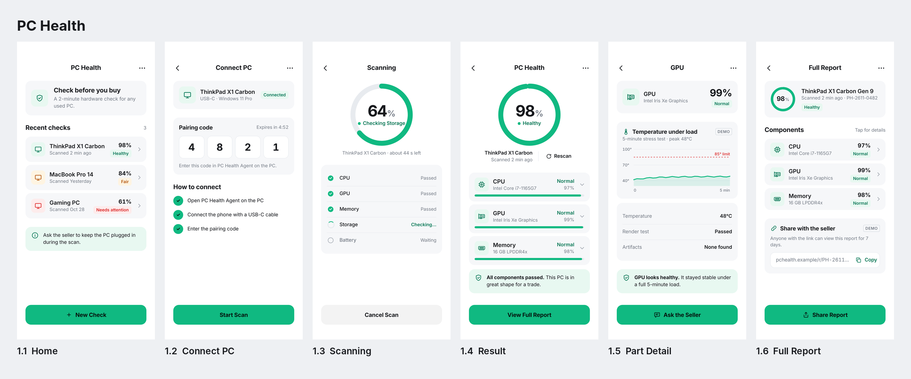
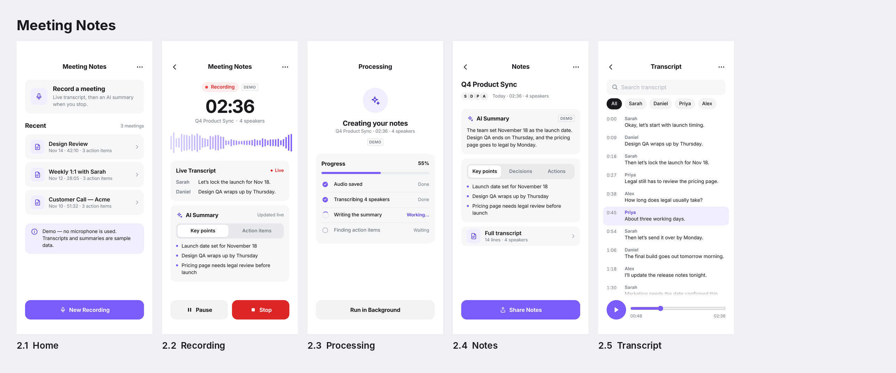
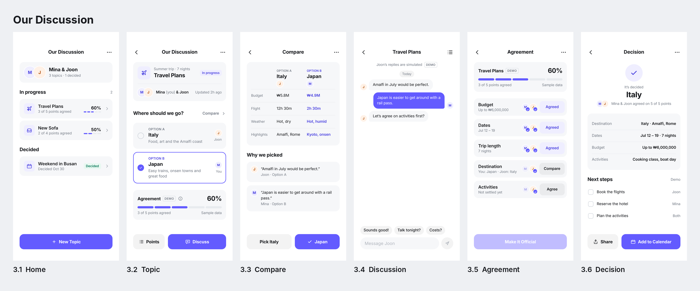

# 시나리오 스토리 — 누가, 언제, 왜 쓰는가

세 앱의 프로토타입이 어떤 사람의 어떤 순간을 위한 것인지 사용자 관점에서 설명합니다. 발표, 기획 공유, 시연 준비에 쓰세요.
화면 파일과 기능 명세는 `apps/scenarios.md`, 화면 보드는 `flows.html`에 있습니다.

> **데모 범위:** 세 앱 모두 데모 데이터로 동작합니다. PC Health는 하드웨어를 읽지 않고, Meeting Notes는 마이크를 쓰지 않으며, Our Discussion의 합의율은 측정값이 아니라 두 사람이 합의로 표시한 항목 수(5개 중 몇 개)입니다. 화면의 `DEMO`·`샘플 데이터` 표시는 이 사실을 알려 주기 위한 것이므로 시연할 때 가리지 마세요.

| | PC Health | Meeting Notes | Our Discussion |
|---|---|---|---|
| 한 줄 | 중고 PC를 사기 전, 그 자리에서 2분 점검 | 회의는 대화에 집중하고, 정리는 AI가 | 둘이서 정해야 할 일을 항목별로 합의 |
| 주인공 | 중고 노트북을 직거래로 사려는 구매자 | 매주 회의를 여러 개 하는 제품 리드 | 여름휴가지를 정하는 부부 |
| 핵심 순간 | 판매자 앞에서 "이거 사도 될까?" | 회의 직후 "뭘 정했고, 누가 뭘 하지?" | "우린 대체 어디까지 합의한 거지?" |
| 대표 화면 ★ | 점검 결과 (98% 양호) | 녹음 중 (실시간 전사·AI 요약) | 토픽 (옵션 선택·합의 60%) |
| 흐름 | 6개 화면 | 5개 화면 | 6개 화면 |
| 끝 | 판매자에게 질문 메시지 · 리포트 공유 | 할 일 체크 · 참석자에게 노트 공유 | 결정 확정 · 다음 할 일 · 캘린더 |

---

## 1 · PC Health — 중고 PC를 사기 전 하드웨어 점검

### 페르소나
**민준 (29세, 대학원생)**
- 연구용 노트북이 필요해서 중고 거래 앱에서 ThinkPad X1 Carbon을 찾았다. 새 제품의 절반 가격이다.
- 오늘 저녁 판매자와 카페에서 직거래하기로 했다.
- 하드웨어를 잘 알지 못한다. 겉보기와 부팅만 확인하고 샀다가, 몇 주 뒤 발열과 메모리 오류를 발견한 경험이 있다.

### 상황과 문제
- 직거래 자리에서 쓸 수 있는 시간은 길어야 10분이다. 판매자 앞에서 이것저것 오래 만지기도 눈치가 보인다.
- 벤치마크 프로그램은 설치가 번거롭고, 결과 숫자를 봐도 사도 되는지 판단하기 어렵다.
- 문제를 발견해도 판매자에게 어떻게 말을 꺼내야 할지 모른다.

### 앱이 약속하는 것
"폰을 케이블로 연결하고 2분이면, **사도 되는지**를 한 문장으로 알려 주고 **판매자에게 할 말**까지 준비해 준다."

### 사용자 여정
| # | 화면 | 민준이 하는 일 | 앱의 반응 | 민준이 얻는 것 |
|---|---|---|---|---|
| 1.1 | 홈 | 카페에 도착해 앱을 열고 **새 점검**을 누른다 | 지난 점검 3건(98% 양호, 84% 보통, 61% 점검 필요)이 보인다 | "전에 본 PC들과 비교할 수 있겠네" |
| 1.2 | PC 연결 | 판매자에게 PC Health Agent를 열어 달라고 하고, USB-C로 연결한 뒤 페어링 코드 4821을 입력한다 | 약 2초 뒤 ThinkPad X1 Carbon이 **연결됨**으로 바뀌고 **점검 시작**이 켜진다. 코드는 5분 뒤 만료된다 | 남의 PC에 연결해도 안전하다는 안심 (코드로 짝지음) |
| 1.3 | 점검 중 | 기다린다 (판매자와 짧게 대화) | 링이 차오르며 CPU → GPU → 메모리 → 저장장치 → 배터리 순으로 통과 표시가 붙는다. 남은 시간이 보인다 | 지금 무엇을 보고 있는지 알 수 있어 기다림이 짧게 느껴진다 |
| 1.4 | 결과 ★ | 점수를 확인하고 GPU 카드를 펼쳐 본다 | **98% 양호** · "모든 부품이 통과했어요. 거래하기 좋은 상태의 PC예요." 부품별 점수와 상태 | 숫자가 아닌 **판단 한 문장** |
| 1.5 | 부품 상세 | **GPU 자세히 보기** → **판매자에게 묻기** → **메시지 복사** | 5분 부하 테스트 온도 그래프(한계 85°), 측정값, 판정. 상태에 맞는 질문 메시지를 만들어 준다 | 판매자에게 그대로 보낼 수 있는 정중한 문장 |
| 1.6 | 전체 리포트 | **리포트 공유**로 링크를 판매자·가족에게 보낸다 | 요약, 부품 3개, 7일간 볼 수 있는 링크 | 거래의 근거 자료가 남는다 |

### 다른 경우 (같은 흐름, 다른 결과)
결과 화면의 **다시 점검**을 누르면 결과가 양호 → 보통 → 점검 필요 순으로 바뀌어 세 가지 경우를 모두 볼 수 있습니다.

| 결과 | 판정 문장 | 판매자에게 묻기 메시지 |
|---|---|---|
| 98% 양호 | 거래하기 좋은 상태의 PC예요 | 정품 충전기와 박스도 함께 주시나요? |
| 84% 보통 | 부하가 걸리면 GPU 온도가 높아요. 구매 전에 쿨링 상태를 물어보세요 | GPU가 91°C까지 올라갔어요. 최근 쿨링 점검을 받은 적 있나요? |
| 61% 점검 필요 | 메모리 오류가 발견됐어요. 수리나 가격 조정을 요청해 보세요 | 판매 전에 수리해 주시거나 가격을 조정해 주실 수 있을까요? |

### 성공 기준
- 연결부터 판정까지 사용자가 누르는 횟수가 3번 이하다 (새 점검 → 점검 시작 → 결과).
- 하드웨어 지식이 없어도 결과 화면 한 장으로 "산다 / 묻는다 / 깎거나 포기한다"를 고를 수 있다.
- 문제가 있을 때 판매자에게 보낼 문장이 바로 준비된다.

### 실제 서비스로 만들 때 필요한 것
PC 쪽 에이전트 프로그램과 실제 진단(온도 센서, 메모리 테스트, 저장장치 SMART, 배터리 사이클), 판정 기준과 점수 계산 방식, 리포트 링크의 보관·만료와 개인정보 처리.

---

## 2 · Meeting Notes — 회의 녹음 → AI 노트

### 페르소나
**지호 (34세, 제품 리드)**
- 하루에 회의를 3~5개 한다. 제품 싱크, 디자인 리뷰, 팀원과의 1:1, 고객 미팅.
- 회의 중에 노트를 적느라 정작 대화에 집중하지 못한다고 느낀다.
- 회의가 끝나면 "그래서 언제까지 누가 뭘 하기로 했지?"를 다시 묻는 일이 잦다.

### 상황과 문제
- 오늘 오후 **4분기 제품 싱크**. 참석자는 서연, 도윤, 하은, 지호. 출시일과 법무 검토 일정을 정해야 한다.
- 손으로 적은 노트는 빠지는 내용이 많고, 녹음 파일은 다시 듣지 않는다.
- 회의 후 결정 사항과 할 일을 정리해 참석자에게 보내는 데 매번 20~30분이 든다.

### 앱이 약속하는 것
"녹음 버튼 하나로 **대화는 그대로 받아 적고**, 멈추면 **요약·결정 사항·할 일**로 정리해 준다. 원문이 필요하면 전사에서 바로 찾는다."

### 사용자 여정
| # | 화면 | 지호가 하는 일 | 앱의 반응 | 지호가 얻는 것 |
|---|---|---|---|---|
| 2.1 | 홈 | 회의실에 들어가 **새 녹음**을 누른다 | 최근 회의 목록(디자인 리뷰, 서연과 주간 1:1, 고객 미팅 — Acme) | 지난 회의 노트로 바로 돌아갈 수 있다 |
| 2.2 | 녹음 중 ★ | 폰을 테이블에 두고 회의에 집중한다. 잠깐 쉴 때 **일시정지**, 다시 **계속** | 타이머와 파형, **실시간 전사**가 화자 이름과 함께 올라온다. 아래 **AI 요약**의 핵심 내용·할 일이 실시간으로 채워진다 | 받아 적지 않아도 된다는 해방감. 지금까지의 요점을 회의 중에도 볼 수 있다 |
| 2.3 | 처리 중 | 회의가 끝나 **정지**를 누른다 | 오디오 저장 → 화자 4명 음성 전사 → 요약 작성 → 할 일 찾기가 차례로 완료된다. **백그라운드에서 계속**도 가능 | 기다리는 동안 무엇이 만들어지는지 보인다 |
| 2.4 | 노트 | 요약을 읽고 **할 일** 탭에서 자기 몫을 체크한다. **노트 공유**로 참석자에게 보낸다 | AI 요약(출시일 11월 18일, 디자인 QA 목요일, 요금 페이지 법무 검토). 핵심 내용 · 결정 사항 · 할 일 탭 | 회의 직후 1분 안에 정리 끝, 참석자 4명에게 같은 기록이 간다 |
| 2.5 | 전사 | "legal"을 검색하고, 하은의 발언만 걸러 본다. 재생을 누른다 | 검색어가 강조되고, 화자 필터로 줄이 걸러진다. 재생하면 현재 줄이 따라 움직이고, 줄을 누르면 그 시점으로 간다 | "법무 검토가 며칠 걸린다고 했지?" — 영업일 3일, 하은의 발언을 10초 만에 확인 |

### 다른 경우
- **지난 회의 열기:** 홈에서 다른 회의를 누르면 같은 노트·전사 화면이 그 회의의 내용(디자인 리뷰, 1:1, 고객 미팅)으로 열립니다.
- **방금 녹음한 회의:** 홈 목록 맨 위에 **새로 만듦** 표시와 함께 올라갑니다.

### 성공 기준
- 회의 중 사용자가 폰을 만지는 건 시작과 정지뿐이다.
- 회의 직후 결정 사항과 담당자가 붙은 할 일이 바로 보인다.
- 원문 근거를 검색 한 번으로 찾을 수 있다.

### 실제 서비스로 만들 때 필요한 것
마이크 권한과 녹음 동의 안내(참석자 고지), 실시간 음성 인식과 화자 분리, 요약·할 일 추출 모델, 저장 위치와 보관 기간, 공유 권한.

---

## 3 · Our Discussion — 부부의 공동 결정

### 페르소나
**미나 (32세)와 준 (33세), 결혼 2년 차 부부**
- 맞벌이라 평일에는 대화할 시간이 짧다. 큰 결정은 메신저로 조금씩 이야기하다가 흐지부지되곤 한다.
- 지금 정해야 할 것: **여름휴가 7박**. 준은 이탈리아, 미나는 일본을 원한다.
- 예산, 날짜, 기간은 이미 맞췄는데, 그 사실이 채팅 기록에 묻혀 매번 처음부터 다시 이야기하게 된다.

### 상황과 문제
- 채팅으로는 "어디까지 합의했는지"가 보이지 않는다.
- 의견이 다른 부분만 남았는데도 대화가 감정 싸움처럼 느껴진다.
- 결정한 뒤 누가 무엇을 예약할지도 따로 정해야 한다.

### 앱이 약속하는 것
"결정을 **항목으로 나눠** 이미 합의한 것과 남은 것을 보여 주고, 비교와 대화를 거쳐 **둘 다 동의했을 때만 확정**한다."

### 사용자 여정 (미나의 시점)
| # | 화면 | 미나가 하는 일 | 앱의 반응 | 미나가 얻는 것 |
|---|---|---|---|---|
| 3.1 | 홈 | 퇴근길에 앱을 열고 **여행 계획**을 누른다 | 진행 중 토픽 2개(여행 계획 60%, 새 소파 50%), 결정된 토픽(부산 주말여행) | 둘이 함께 정할 일들이 한곳에 |
| 3.2 | 토픽 ★ | 현재 상태를 본다 | 옵션 A 이탈리아(준의 선택), 옵션 B 일본(내 선택). **합의 60%** = 5개 중 3개(예산·날짜·기간) | "남은 건 목적지와 활동뿐이구나" |
| 3.3 | 비교 | **비교**를 열어 두 곳을 나란히 본다 | 예산 580만 원 vs 490만 원, 비행 12시간 30분 vs 2시간 30분, 날씨, 볼거리. 각자 고른 이유 한 문장 | 감정이 아니라 조건으로 이야기할 수 있다 |
| 3.3 | 비교 | 준의 이유("7월의 아말피라면 완벽할 거야")에 마음이 기울어 **이탈리아 선택** | "둘 다 이탈리아를 골랐어요" — 목적지가 자동으로 합의되고, 토픽으로 돌아가면 **80%** | 한 번의 선택이 합의로 이어진다 |
| 3.4 | 대화 | **대화하기**에서 빠른 답장 "좋아!"를 보낸다 | 준이 입력 중… 표시 뒤 답장이 온다 (데모에서는 시뮬레이션) | 앱을 벗어나지 않고 이야기를 이어 간다 |
| 3.5 | 합의 | 목록 아이콘으로 합의 항목을 열고 **활동**에 동의한다 | 5개 항목 × 두 사람의 상태. 5개 중 5개가 되면 **확정하기**가 켜진다 | 서로 무엇에 동의했는지 명확한 기록 |
| 3.6 | 결정 | **확정하기** | "결정됐어요 — 이탈리아". 아말피·로마, 7월 12일–19일 · 7박, 최대 600만 원, 요리 수업·보트 투어. 다음 할 일: 항공권(준), 호텔(미나), 활동 계획(둘 다). **캘린더에 추가** | 결정이 끝이 아니라 바로 실행으로 |

돌아가면 홈의 **결정됨**에 여행 계획이 올라갑니다.

### 다른 경우
- **목적지가 다를 때:** 다른 항목을 모두 합의해도 같은 옵션을 고르기 전까지 확정할 수 없습니다(합의 화면에 "같은 옵션을 골라야 해요").
- **결정 전에 결정 화면을 열면:** "아직 결정되지 않았어요 — 모든 항목에 합의하면 확정할 수 있어요"가 보입니다.

### 성공 기준
- 앱을 열자마자 "어디까지 합의했고 무엇이 남았는지"가 한 화면에 보인다.
- 의견 차이를 비교 표와 각자의 이유로 이야기할 수 있다.
- 한 사람이 혼자 확정할 수 없다. 두 사람 모두 모든 항목에 동의해야 한다.

### 실제 서비스로 만들 때 필요한 것
두 사람 계정 연결과 실시간 동기화, 푸시 알림, 토픽 템플릿(여행·가구·이사 등), 비교 정보 입력 방식, 캘린더 연동. 합의율은 지금처럼 **사람이 표시한 항목 수**로 계산하고, 대화 내용을 분석한 점수처럼 보이지 않게 한다.

---

## 시연 대본 (앱당 약 1분)

`index.html`에서 시나리오 옆의 **▶ 실행**을 누르면 데모 데이터가 초기화된 첫 화면부터 시작합니다. 폰에서 시연하려면 같은 Wi-Fi에서 PC의 주소로 각 시나리오의 첫 화면을 엽니다(`apps/scenarios.md` 참고). 언어는 하단 버튼이나 `?lang=ko`, 테마는 `?theme=dark`.

**PC Health** — "중고 노트북을 직거래로 산다고 해 볼게요."
새 점검 → (2초 뒤 연결됨) 점검 시작 → (7초 점검) 98% 양호 → GPU 카드 펼치기 → 자세히 보기: 부하 온도 그래프 → 판매자에게 묻기 → 메시지 복사 → 뒤로 → 전체 리포트 보기 → 공유.
*포인트:* 숫자가 아니라 판단 문장과 판매자에게 할 말을 준다. 결과에서 다시 점검을 두 번 누르면 문제가 있는 경우도 보여 줄 수 있다.

**Meeting Notes** — "회의를 시작하면서 녹음을 켭니다."
새 녹음 → 실시간 전사와 AI 요약이 채워지는 모습 → 일시정지·계속 → 정지 → (5초 처리) 노트: 요약 → 할 일 탭에서 하나 체크 → 전체 전사 → "legal" 검색 → 재생.
*포인트:* 회의 중 손이 가는 건 시작과 정지뿐. 정리된 결과와 원문 근거가 연결돼 있다.

**Our Discussion** — "부부가 휴가지를 정하고 있어요. 이미 5개 중 3개는 합의했습니다."
여행 계획 → 합의 60% → 비교 → 이탈리아 선택(목적지 합의, 80%) → 뒤로 → 대화하기 → 빠른 답장 → 준의 답장 → 합의 항목 → 활동 동의(5/5) → 확정하기 → 결정 화면.
*포인트:* 합의 현황이 보이고, 둘 다 동의해야만 확정된다. 결정은 바로 다음 할 일로 이어진다.

---

## 새 앱의 시나리오 스토리를 쓸 때
앱을 추가하면 이 문서에 같은 형식으로 절을 추가하세요: 한 줄 약속 → 페르소나 → 상황과 문제 → 사용자 여정 표(화면 · 하는 일 · 앱의 반응 · 얻는 것) → 다른 경우 → 성공 기준 → 실제 서비스로 만들 때 필요한 것 → 시연 대본. 사용자 여정의 화면은 `apps/scenarios.md`의 화면 번호와 맞춥니다.
